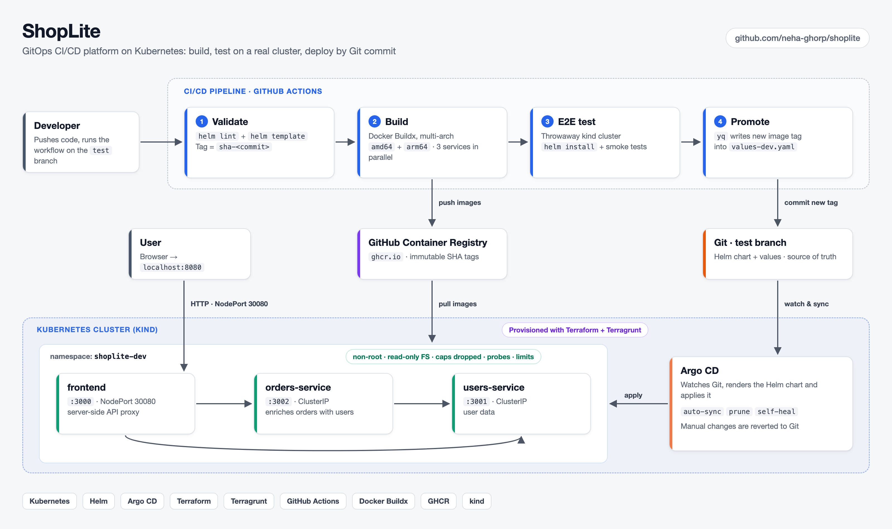
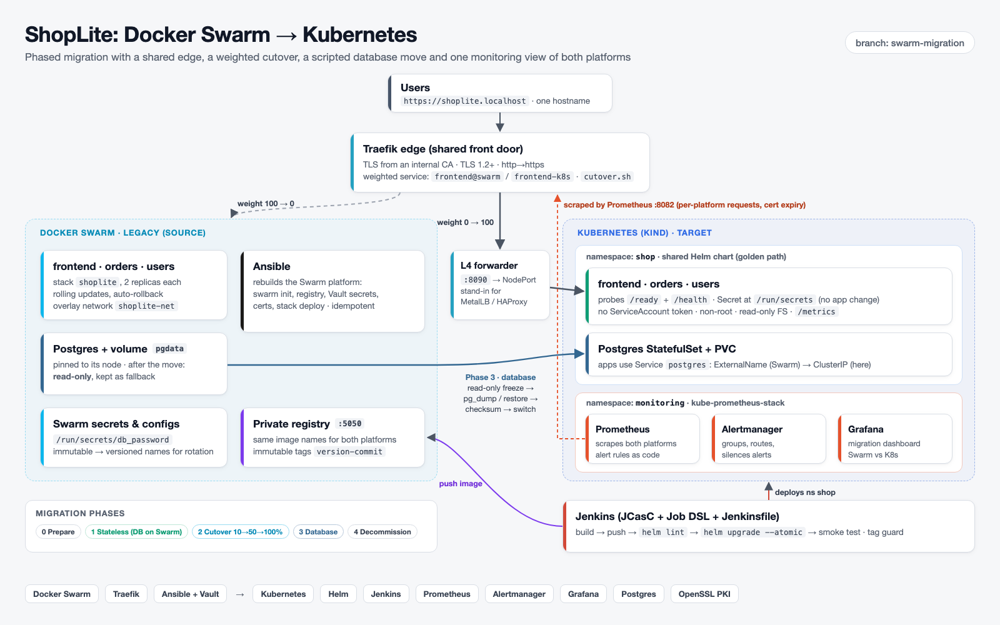

# ShopLite: GitOps Delivery on Kubernetes

An end-to-end DevOps project: three Node.js microservices, provisioned with **Terraform/Terragrunt**,
packaged with **Helm**, built and tested by **GitHub Actions**, and continuously deployed by **ArgoCD**
to a Kubernetes (kind) cluster.

The application itself is deliberately small. The focus is the platform around it: infrastructure as code,
a CI pipeline that tests on a real cluster before it ships, and Git as the only way to change what runs.

The [`swarm-migration`](https://github.com/neha-ghorp/shoplite/tree/swarm-migration) branch adds a second scenario:
the same app running on a **Docker Swarm** "legacy" platform, migrated service by service to Kubernetes with a weighted
cutover, a scripted database move, **Jenkins**, **Ansible** and **Prometheus/Grafana**. See
[Swarm → Kubernetes migration](#swarm--kubernetes-migration).


## What this project demonstrates

- **Infrastructure as code**: Terraform modules for the cluster and ArgoCD, wired per environment with Terragrunt (DRY config, separate state per component).
- **GitOps**: ArgoCD with automated sync, `prune` and `selfHeal`. The cluster always matches Git, and manual `kubectl` changes get reverted.
- **CI/CD with a real test gate**: every build is deployed to a throwaway kind cluster inside the pipeline and smoke-tested end to end before the new tag is promoted.
- **Multi-arch images**: Docker Buildx + QEMU build `linux/amd64` and `linux/arm64`, so the same tag runs on cloud runners and Apple Silicon.
- **Immutable, traceable releases**: images are tagged `sha-<commit>`, and the deployed version is a commit in Git, so a rollback is a `git revert`.
- **Secure-by-default pods**: non-root user, read-only root filesystem, all Linux capabilities dropped, no privilege escalation, resource requests/limits, liveness and readiness probes.
- **One Helm chart for many services**: a single templated chart renders a Deployment and Service per service, with per-environment overrides.
- **Swarm → Kubernetes migration** (branch `swarm-migration`): stateless services first on the old database, traffic shifted at the edge by weight with a tested rollback, the database moved last with a read-only freeze and checksum check, and one monitoring view across both platforms.

## Architecture



**Request flow:** `frontend` → `orders-service` → `users-service`. The frontend proxies API calls server-side,
so internal services are never exposed outside the cluster. Services find each other through Kubernetes DNS
(`http://users-service:3001`).

## CI/CD pipeline

[`.github/workflows/ci-cd.yaml`](.github/workflows/ci-cd.yaml)

| Stage | What it does |
|---|---|
| **validate** | `helm lint` and `helm template` the chart, and compute the image tag `sha-<commit>` |
| **build** | Matrix build of the 3 services with Buildx (amd64 + arm64), pushed to ghcr.io with layer caching |
| **e2e** | Creates a kind cluster on the runner, installs the chart with the new tag, and runs [`scripts/e2e-test.sh`](scripts/e2e-test.sh). On failure it dumps pod status, events and logs. |
| **promote** | Writes the new tag into `helm/shoplite/values-dev.yaml` with `yq` and commits it to `test`. ArgoCD then rolls it out. |

The pipeline never runs `kubectl` against the dev cluster. Deployment is only ever a Git commit, and ArgoCD pulls it in.

## Repository layout

```
apps/                      3 Node.js services, each with a Dockerfile
docker-compose.yml         run everything locally without Kubernetes
helm/shoplite/             one chart for all services (values.yaml + values-dev.yaml)
terraform/modules/         reusable modules: kind-cluster, argocd
terragrunt/dev/            dev environment wiring the modules (root.hcl holds shared config)
argocd/shoplite-dev.yaml   ArgoCD Application: tracks helm/shoplite on the test branch
.github/workflows/         CI/CD pipeline
scripts/e2e-test.sh        end-to-end smoke test (used in CI and locally)
docs/                      architecture diagrams (PNG + editable HTML source)

# swarm-migration branch
swarm/                     legacy platform: docker-stack.yml, Traefik TLS + cutover config, certs script,
                           cutover.sh (traffic weights), migrate-db.sh (database move), edge-lb.sh
swarm/ansible/             playbook + roles that rebuild the Swarm platform (secrets in Ansible Vault)
helm/shoplite/values-migration.yaml   the migrated app in namespace "shop" (Postgres StatefulSet, ServiceMonitor)
jenkins/                   Jenkins as code: image, JCasC, Job DSL, Jenkinsfile, run.sh
monitoring/                kube-prometheus-stack values, alert rules, Grafana dashboard JSON
```

## Design decisions

- **ArgoCD tracks `test`, not `main`.** `main` is branch-protected, so the pipeline can't push tag bumps to it. `test` acts as the dev environment branch, and promotion to other environments would happen by PR.
- **Helm rendered by ArgoCD, not `helm install`.** Git is the source of truth. There is no Helm release state in the cluster to drift from it, and rollback means reverting a commit.
- **e2e on an ephemeral cluster.** A broken image or chart fails in CI and never reaches the dev environment.
- **Terragrunt over plain Terraform.** It keeps the state backend config in one place (`root.hcl`) and gives each component its own state, so adding a `staging/` environment is a copy of `dev/` with different inputs.
- **Numeric `runAsUser`.** The images run as the non-root `node` user. Kubernetes can only enforce `runAsNonRoot` with a numeric UID, so the chart sets `runAsUser: 1000`.

## Swarm → Kubernetes migration

On the [`swarm-migration`](https://github.com/neha-ghorp/shoplite/tree/swarm-migration) branch, ShopLite first runs on
Docker Swarm as a realistic legacy platform: an overlay network, Swarm secrets and configs, Postgres on a node-local volume,
and Traefik terminating TLS with a certificate from a private CA. It is then moved to Kubernetes without changing the
user-facing URL and with a rollback available at every step.



### Phases

| Phase | What happens | How | Result in the lab |
|---|---|---|---|
| **0 Prepare** | Kubernetes can pull from the same registry; inventory and Swarm → Kubernetes mapping | containerd registry config, mapping table | same image names on both platforms |
| **1 Stateless** | frontend, orders and users run on Kubernetes but still use the **Swarm database** | shared chart: probes, Secret at `/run/secrets`, Service `postgres` as `ExternalName` | both platforms serve the same data |
| **2 Cutover** | Traefik splits traffic by weight: 100/0 → 90/10 → 50/50 → 0/100 | [`swarm/cutover.sh`](swarm/cutover.sh) edits a file Traefik watches (no restart) | 300 requests, **0 errors**; rollback to Swarm in seconds |
| **3 Database** | Postgres moves into a StatefulSet | [`swarm/migrate-db.sh`](swarm/migrate-db.sh): read-only freeze → `pg_dump`/restore → row count + checksum (auto-abort on mismatch) → Service switch → app restart | checksums matched, reads never failed |
| **4 Decommission** | keep the Swarm DB read-only as a fallback, then remove the stack and move the edge to a Kubernetes Ingress | planned | — |

The database moves last on purpose: while both platforms share one database, traffic can move back and forth freely.
The first write on the new database is the point of no return.

### Platform pieces

| Area | Implementation |
|---|---|
| **Swarm platform** | [`swarm/docker-stack.yml`](swarm/docker-stack.yml): rolling updates with `start-first` and auto-rollback, resource limits, healthchecks, Postgres pinned to its node, Traefik with TLS 1.2+ |
| **TLS** | [`swarm/make-certs.sh`](swarm/make-certs.sh): root CA (with `keyUsage`/`basicConstraints`, so strict clients accept it) and a 90-day server certificate with SANs |
| **Ansible** | [`swarm/ansible/`](swarm/ansible/): idempotent roles (swarm, registry, shoplite); DB password from Ansible Vault; rebuilds the whole Swarm platform in about 30 s |
| **Kubernetes** | shared chart with per-service tags, readiness/liveness paths, Secret files, ServiceMonitors, and Postgres in `external` / `migrating` / `internal` mode |
| **Jenkins** | [`jenkins/`](jenkins/): controller image with pinned kubectl/Helm, JCasC + Job DSL (no UI configuration), Jenkinsfile: immutable `version-commit` tag guard → build → push → `helm lint` → `helm upgrade --atomic` → smoke test |
| **Monitoring** | [`monitoring/`](monitoring/): kube-prometheus-stack; Prometheus also scrapes Swarm's Traefik, so one Grafana dashboard compares both platforms (error rate, share of traffic on Kubernetes, p95 latency, TLS days left); alert rules with runbooks |

### Problems found along the way

- Kubernetes ignores Docker `HEALTHCHECK`, so every service needs explicit probes.
- Mounting Secrets at Swarm's `/run/secrets` collided with the ServiceAccount token (`/var/run` → `/run`). Fixed with `automountServiceAccountToken: false`, which is also least privilege.
- Swarm secrets and configs are immutable: certificate rotation needs versioned secret names (content hash) and a rolling update.
- A StatefulSet's `serviceName` is immutable, so the app-facing Service and the StatefulSet's headless Service are separate.
- Connection pools keep old connections after a database switch, so the apps are restarted deliberately.
- An interrupted `helm upgrade --wait` left the release stuck in `pending-upgrade`; fixed with `helm rollback`.
- Jenkins job parameters defined only in a Jenkinsfile vanish after a JCasC/Job DSL restart, so they are declared in Job DSL too.
- A database-outage drill fired the alert within ~90 s, but also crashed every users-service pod: the `pg` pool's `error` event had no listener. Fixed, released through Jenkins, and the rerun showed pods leaving traffic with **zero restarts** and recovering 9 s after the database returned.

### Run it

Requires the kind cluster from [Run it yourself](#run-it-yourself), plus `ansible` and `yq`.

```sh
git checkout swarm-migration
docker swarm init
cd swarm/ansible && ansible-playbook site.yml && cd ../..     # Swarm platform: https://shoplite.localhost
./swarm/edge-lb.sh                                            # L4 forwarder to the kind NodePort
kubectl create namespace shop
kubectl -n shop create secret generic db-password --from-literal=db_password='<vault value>'
helm upgrade --install shop helm/shoplite -n shop -f helm/shoplite/values-migration.yaml --set postgres.mode=external
./swarm/cutover.sh 50 50                                      # shift traffic; 100 0 rolls back
./jenkins/run.sh                                              # Jenkins on http://localhost:8085
helm upgrade --install monitoring prometheus-community/kube-prometheus-stack \
  -n monitoring --create-namespace -f monitoring/values.yaml
kubectl apply -f monitoring/alerts.yaml && ./monitoring/ui-forward.sh
```

### Known shortcuts

This is a single-machine lab. In production the edge proxy would sit outside both platforms (HAProxy/F5 or MetalLB),
Jenkins would build on ephemeral agents with Kaniko/BuildKit instead of the Docker socket, deploys would go through
GitOps instead of `helm --set`, secrets through External Secrets or Vault, and Postgres would use an operator such as
CloudNativePG with backups.

## Run it yourself

### Prerequisites

`docker`, `kubectl`, `terraform`, `terragrunt`, `helm`, `kind`:

```sh
brew install terraform terragrunt helm kind kubectl
```

### 1. Create the cluster and install ArgoCD

```sh
cd terragrunt/dev
terragrunt run --all apply      # older terragrunt: terragrunt run-all apply
kubectl config use-context kind-shoplite-dev
```

ArgoCD UI: http://localhost:8081 (user `admin`). Get the password with:

```sh
kubectl -n argocd get secret argocd-initial-admin-secret -o jsonpath='{.data.password}' | base64 -d
```

### 2. Hand the app to ArgoCD

```sh
kubectl apply -f argocd/shoplite-dev.yaml
kubectl -n argocd get application shoplite-dev -w     # wait for Synced / Healthy
```

App: http://localhost:8080

### 3. Run the end-to-end test

```sh
scripts/e2e-test.sh http://localhost:8080
```

### Ship a change

GitHub → Actions → **CI/CD** → Run workflow → branch `test`. The pipeline builds, tests and commits the new tag,
and ArgoCD rolls it out.

> Forking this repo? ghcr.io packages start out private. After the first pipeline run, make the 3 packages public
> (Profile → Packages → package → Package settings → Change visibility) so the cluster can pull them.

### Without ArgoCD

```sh
docker compose up --build                                   # plain Docker
helm install shoplite helm/shoplite -f helm/shoplite/values-dev.yaml -n shoplite-dev --create-namespace
```

### Tear down

```sh
kubectl delete -f argocd/shoplite-dev.yaml
cd terragrunt/dev && terragrunt run --all destroy
```

## Troubleshooting practice

This cluster is also used to practice breaking and fixing things the GitOps way. For example, a bad
`NODE_OPTIONS` value was committed to cause a CrashLoopBackOff, debugged with `describe` and `logs --previous`
(exit code 1, `Cannot find module`), and fixed in Git, because with ArgoCD `selfHeal` a direct `kubectl` fix
would be reverted. The rolling update kept the old pod serving, so the bad deploy caused no downtime.
See the `lab:` and `fix(dev):` commits in the history.

## Roadmap

- [ ] Ingress controller instead of NodePort
- [x] Prometheus + Grafana monitoring (on `swarm-migration`)
- [ ] External Secrets Operator for secret management
- [ ] Staging environment with PR-based promotion
- [ ] HPA and PodDisruptionBudgets
- [ ] Deploy to EKS using the same Terragrunt layout
